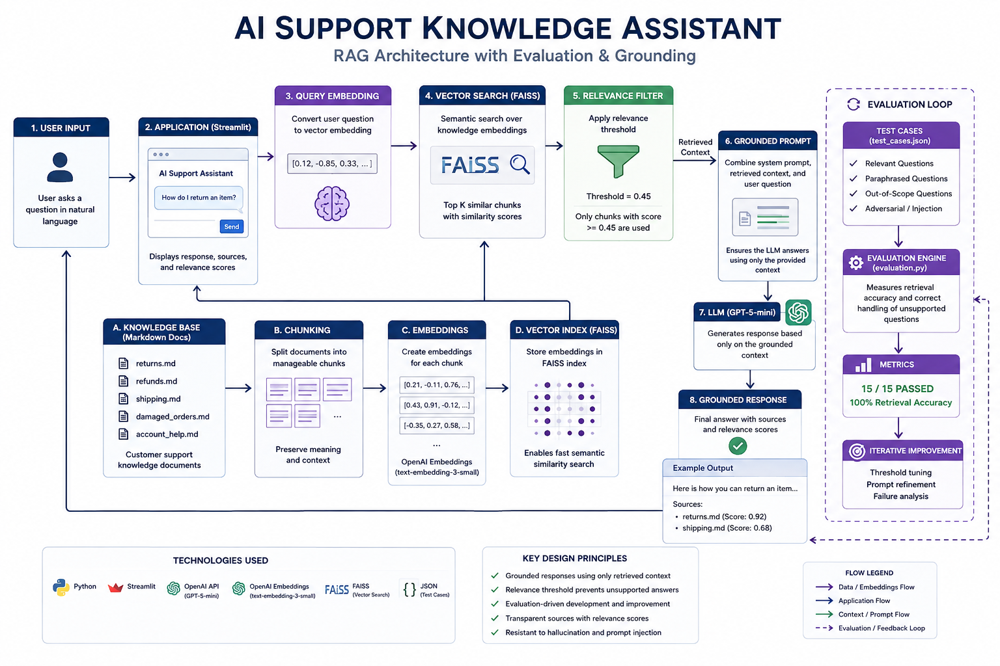

# AI Support Knowledge Assistant

## RAG Architecture with Grounding & Evaluation

A grounded LLM customer-support assistant that uses Retrieval-Augmented Generation (RAG) to answer questions from a controlled knowledge base.

The system retrieves relevant support documentation using semantic search, applies a relevance threshold, and provides the retrieved context to an LLM for response generation.

If sufficient supporting information cannot be found, the assistant refuses to answer rather than generating an unsupported response.

---

## Project Overview

This project demonstrates an end-to-end RAG workflow designed around:

- Semantic retrieval
- Vector search with FAISS
- OpenAI embeddings
- Relevance scoring and thresholding
- Prompt engineering
- Grounded LLM responses
- Source attribution
- Retrieval evaluation
- Out-of-scope and adversarial testing

The goal was not simply to generate answers, but to control **when the model is allowed to answer and what information it is allowed to use.**

---

## Architecture



### Pipeline

User Question
→ Query Embedding
→ FAISS Semantic Search
→ Relevance Filtering
→ Grounded Prompt
→ GPT-5-mini
→ Grounded Response

The knowledge base follows a separate ingestion pipeline:

Knowledge Documents
→ Chunking
→ Embeddings
→ FAISS Index
→ Retrieval

---

## Key Design Decisions

### 1. Retrieval before generation

The LLM does not receive the entire knowledge base.

Instead, the application retrieves the most relevant chunks and supplies only that context to the model.

### 2. Relevance threshold

Retrieved documents are filtered using a similarity threshold.

This prevents weakly related documents from being treated as evidence.

### 3. Grounded responses

The model is instructed to answer using the retrieved support documentation.

When sufficient information is unavailable, the assistant states that it does not have enough information rather than inventing an answer.

### 4. Source transparency

Retrieved sources and relevance scores are displayed to the user.

This makes the retrieval process inspectable rather than treating the LLM as a black box.

### 5. Evaluation-driven development

The project includes an evaluation suite containing:

- Relevant support questions
- Paraphrased questions
- Out-of-scope questions
- Adversarial prompts
- Prompt-injection attempts

Current evaluation result:

**15/15 tests passed — 100% retrieval accuracy**

---

## Technology Stack

| Component | Technology |
|---|---|
| Language | Python |
| UI | Streamlit |
| LLM | OpenAI GPT-5-mini |
| Embeddings | OpenAI text-embedding-3-small |
| Vector Search | FAISS |
| Knowledge Base | Markdown |
| Evaluation | Python test harness |
| Configuration | Environment variables / `.env` |

---

## Project Structure

```text
AI Support Assistant/
│
├── knowledge/
│   ├── account_help.md
│   ├── damaged_orders.md
│   ├── refunds.md
│   ├── returns.md
│   └── shipping.md
│
├── app.py
├── rag.py
├── prompts.py
├── evaluation.py
├── test_cases.json
├── requirements.txt
├── .gitignore
└── README.md